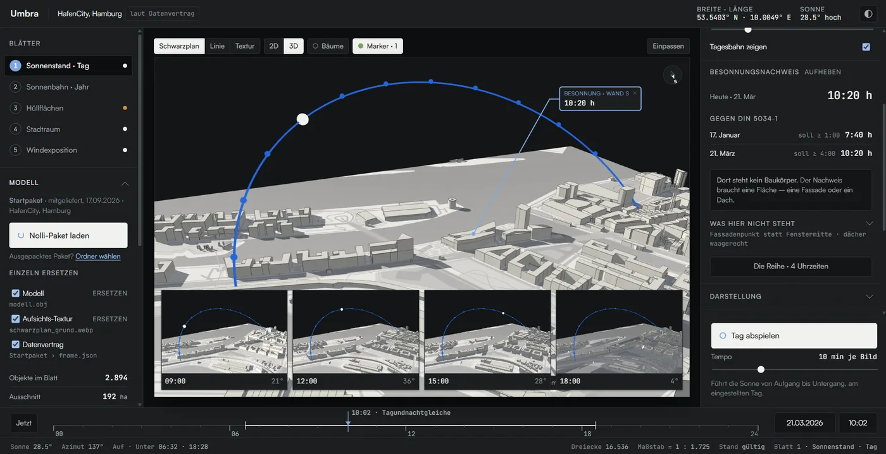
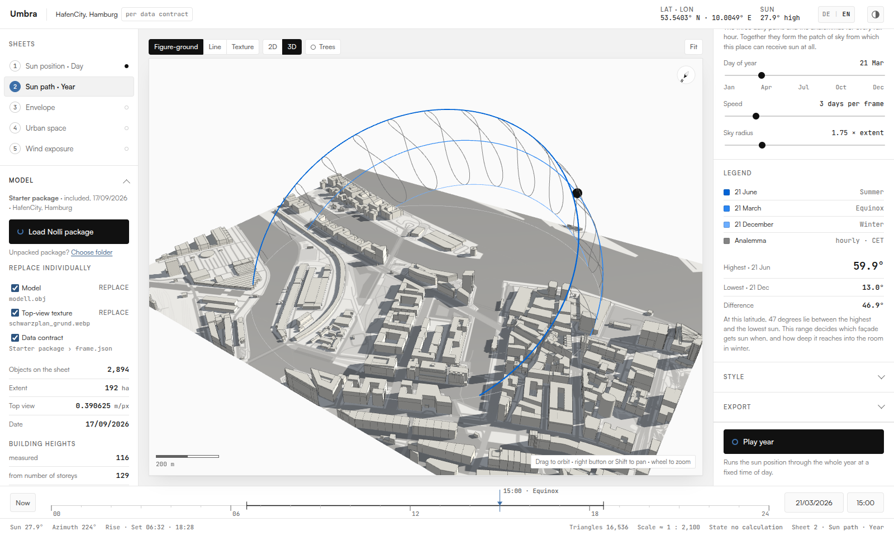
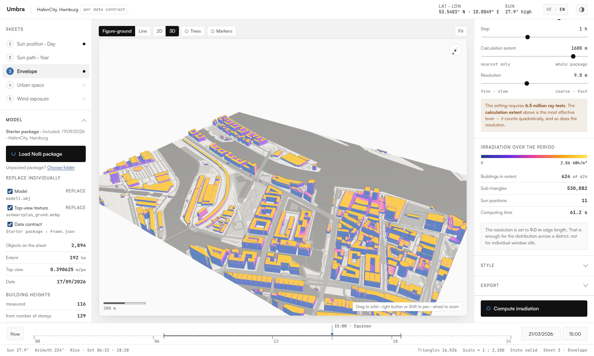
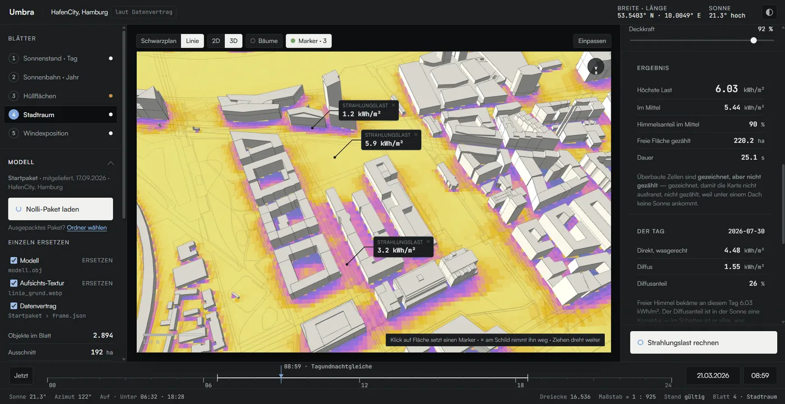
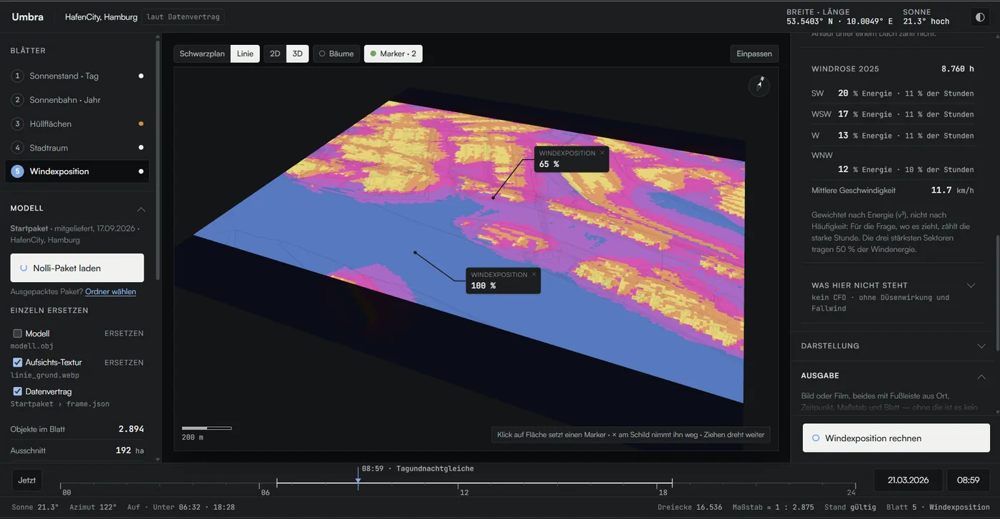

# Umbra

**Sun, irradiation and wind on an urban model, in the browser.** Umbra takes a
site package from [Nolli](https://github.com/yougop/nolli) and computes how
long a façade is in the sun (checked against DIN 5034-1), how much radiation
falls on every surface over a period, how much the ground between the
buildings receives on a hot day, and how freely a place is exposed to the
wind.

Umbra is a single HTML file. There is no build step, no server-side code, no
account and no API key. Your files are read in the browser and sent nowhere.

**Live:** [zinssmeister.info/app/umbra](https://zinssmeister.info/app/umbra/) ·
project page [zinssmeister.info/umbra](https://zinssmeister.info/umbra)



## Where it sits

Umbra is the third step of a chain. Nolli sets a measured frame over the
existing city and draws figure-ground plans — with building shadows from a
**fixed artificial sun** (north-west, 48.8° high, the same on every day of the
year). Umbra computes the same shadows with the **real** sun for the place and
the moment, in three dimensions, and turns them into hours of sunlight and
irradiation.

## The five sheets

| Sheet | Question | How |
|---|---|---|
| **1 · Sun position · Day** | Is this point in the sun, and for how long? | Daily sun path and cast shadows at the set time. Click a façade or roof with **Markers** on: Umbra counts the sunlit minutes in 5-minute steps against the loaded model and checks them against DIN 5034-1 (≥ 1 h on 17 January, ≥ 4 h at the equinox). **The series** renders four times of day side by side. |
| **2 · Sun path · Year** | From which patch of sky can this place get sun at all? | The daily paths of 21 June, 21 March and 21 December, and the analemmas for every full hour. |
| **3 · Envelope** | How much direct radiation hits each façade and roof? | One ray per sub-triangle towards the sun, weighted by the angle of incidence, with self- and neighbour shading. At an instant (W/m²) or summed over a period (Wh/m²). |
| **4 · Urban space** | What does the ground between the buildings receive on a hot day? | Direct sun where it reaches, plus diffuse radiation weighted by the visible share of sky (72 directions). Hourly values for the hottest day of last summer from Open-Meteo; any other day can be entered. Tree crowns attenuate with an assumed transmission (25 % by default). Also shows the sky view, a proxy for night-time cooling. |
| **5 · Wind exposure** | How open is a point to the wind that actually blows here? | The free fetch in 16 directions, weighted by the energy (v³) of a measured wind rose for the past year from Open-Meteo, at 1.5 m above ground. |






Every sheet can be exported as a PNG or as a WebM film over the day or the
year, always with a footer of place, time, sun position, scale and sheet —
without it, an image is no proof. The **tile for the package** matches the
resolution and frame of the Nolli package exactly, so it lies congruently on
Nolli's own images.

## What it does not compute

Umbra says where its basis is weak, on the sheet, next to the number it
qualifies. The caveats come from the data contract, not from Umbra's code:

- **Flat roofs.** Every building has one height and a flat roof. Pitch, ridge
  and stepped eaves are unknown, because OpenStreetMap records a building as
  one outline. For shadow casting this is secondary.
- **Courtyards.** Older packages do not cut courtyards out of perimeter
  blocks; the courtyard then lies under a roof and sunlight values there are
  too low. Umbra assumes this whenever a contract does not state otherwise.
- **Terrain on a plate.** Umbra computes on a flat plate. If a package brings
  terrain, every building is set down to zero and the terrain itself is
  dropped. On a slope, shading is underestimated downhill and overestimated
  uphill; the slope as a shadow caster is missing.
- **Heights.** Building heights are measured where OpenStreetMap has a
  `height`, otherwise derived from the number of storeys, otherwise assumed at
  8 m. Umbra shows the breakdown for the buildings (not the building parts,
  which flatter the figure): in the starter package 116 measured, 129 from
  storeys, 93 assumed — 28 % of the buildings but 44 % of the footprint area.
- **Sheet 1** measures on the façade, not at the window centre inside as the
  standard does, which is the more favourable assumption.
- **Sheet 3** counts direct radiation under a cloudless sky only; diffuse
  radiation and ground reflection are missing, so the figure is an upper
  bound.
- **Sheet 4** is radiation, not temperature: air temperature, wind at
  pedestrian height and heat stored in paving are not included.
- **Sheet 5 is not CFD.** No speeds, no recirculation, no comfort criteria
  (Lawson, NEN 8100); channelling in narrow passages and downdraught in front
  of tall buildings are missing.
- **Clock.** Times are Central European (CET/CEST), wherever the site is.

## Loading a Nolli package

1. Make a package in [Nolli](https://zinssmeister.info/app/nolli/):
   frame → clean up → export → **Package** (ZIP).
2. In Umbra, **Load Nolli package** and pick the ZIP — or **Choose folder**
   for an unpacked one.

Umbra reads `frame.json` first: it sets location, frame, scale and
provenance, and checks that the model, the top view and the contract belong
together (pixel size, central meridian, origin). Then it loads `model.obj`,
the bare ground textures (figure-ground, line, texture, …) and the trees.

Both contract versions are read. Nolli writes **contract v2** since 14 October
2026 (`"contract": "nolli", "contract_version": 2`, English field and file
names); Umbra maps it back onto the v1 names it computes with. The mapping
table `NOLLI_V2` in `umbra.html` is generated from Nolli's
[`vertrag.ts`](https://github.com/yougop/nolli/blob/main/werkzeug/src/lib/vertrag.ts)
and checked by Nolli's `pruefung/vertrag.mjs` against this file — it is not
edited by hand.

Individual layers can be replaced too (**Replace individually**): an OBJ, GLB
or GLTF model from Rhino or Blender, a top-view image, or a contract.

## Language

The interface switches between German and English (top right, **DE | EN**).
The choice is stored in the browser as `umbra.sprache`; otherwise the browser
language decides. Numbers, dates and times follow the language (`de-DE`,
`en-GB`). Terms match Nolli: *frame*, *data contract*, *sheet*,
*figure-ground*, *white model* …

## Running it

Umbra fetches its starter package, so it needs to be served over HTTP, not
opened as a file:

```bash
git clone https://github.com/yougop/umbra
cd umbra
python3 -m http.server 8777
# http://127.0.0.1:8777/umbra.html
```

To publish, put `umbra.html` (as `index.html` if you like), `schrift/` and the
starter package files from `modelle/` on any static web server.
`./pruefe-lieferung.sh` lists exactly which files that is, with checksums,
read from the references in `umbra.html`. three.js and three-mesh-bvh come
from jsDelivr.

## Checks

| Script | Checks |
|---|---|
| `./pruefe-lieferung.sh` | Which files a deployment needs; existence and checksums |
| `./pruefe-stand.sh [url]` | Whether the deployed `umbra.html` is this one (separate exit codes for unreachable, HTTP error, and "status 200 but not Umbra") |
| `node pruefe-sprache.mjs [dir]` | Walks the English interface — every sheet, both views, trees, markers, the sunlight check — and reports German leftovers; then switches to German and back. Needs `npm install` (puppeteer-core) and a Chrome (`$CHROME` or `~/.cache/puppeteer`) |

## Repository layout

```
umbra.html          everything: markup, styles, sun and ray-casting core, both languages
schrift/            Satoshi and JetBrains Mono, the same cuts as Nolli
modelle/            starter package: HafenCity, Hamburg (Nolli contract v2)
  hcu-demo/         older HafenCity University models, not loaded at start
docs/               screenshots for this README
bilder/             screenshots for the project page
LIESMICH.md         working notes in German: decisions, numbers, deployment
PRODUCT.md          product brief (German)
DESIGN.md           design system (German)
.impeccable/        design direction and contract for the Impeccable workflow
```

The code and its comments are written in German; the interface is bilingual.

## Data sources and attribution

- **Starter package** — built with Nolli from **OpenStreetMap**,
  © OpenStreetMap contributors, ODbL.
- **Weather and wind** — [Open-Meteo](https://open-meteo.com/), CC BY 4.0
  (hourly radiation, temperature archive, wind rose).
- **Place search** — Nominatim (OpenStreetMap).
- **Sun position** — NOAA solar position algorithm.
- **Rendering** — [three.js](https://threejs.org/) and
  [three-mesh-bvh](https://github.com/gkjohnson/three-mesh-bvh), MIT.
- **Colour ramp** on sheets 3 and 4 after [Ladybug Tools](https://www.ladybug.tools/).
- **Fonts** — Satoshi by Indian Type Foundry (Fontshare), JetBrains Mono
  (SIL Open Font License).
